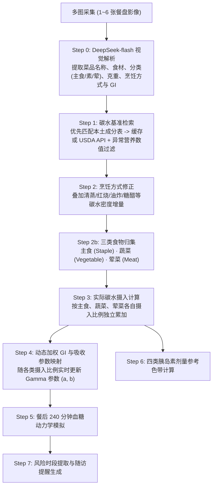

# 糖控助手 (GI-Checker) —— 产品规格与系统架构文档

**糖控助手**（包名：`com.example.diabetesassistant`）是一款面向糖尿病患者及血糖管理人群的 Android 移动端饮食评估与餐后代谢辅助管理软件。系统基于多模态视觉识别与医学营养学模型，支持通过餐盘影像自动解析食材构成、估算净碳水化合物与血糖生成指数（Glycemic Index, GI），并结合个体生理参数推演餐后 240 分钟血糖变化趋势及胰岛素参考剂量区间。所有健康档案、影像数据及历史记录均持久化存储于设备本地，保障敏感个人健康数据的隐私安全。

---

## 一、 需求识别与产品定位

### 1.1 临床需求背景
在糖尿病医学营养治疗（MNT）的日常实践中，患者进行饮食记录与餐前评估通常面临以下核心需求与难点：

1. **中餐非标准化烹饪与快速估重需求**：中式饮食多为复合菜肴与汤羹，日常用餐时难以逐项称重，因此需要无需额外参照物（如硬币或标尺）、直接基于常见餐具视觉比例即可完成多菜品合并估算的识别方案；同时，针对汤品中的泡发干货（如紫菜、木耳）及高水分凝胶类食品（如冰粉、凉粉），需要区分其复水或高水分形态与脱水干品之间的巨大密度差异。
2. **中餐营养成分的本土化准确匹配**：通用英文食品数据库以欧美包装食品为主，在中餐常见食材的跨语言检索中容易出现词义偏差（例如将全蛋匹配为干制鸡蛋挂面，或将凝胶小吃匹配为纯干淀粉）。软件需要以《中国食物成分表》标准数据作为优先基准，并辅以异常营养数值过滤机制，确保本土菜品计算贴近真实营养含量。
3. **贴合临床膳食结构的进食比例调节**：在糖尿病“211 餐盘法”（即保证足量非淀粉蔬菜、适量优质蛋白，并严格控制精制主食）的饮食指导中，精制主食（米饭、面条，碳水密度 25~30g/100g，GI 75~85）与非淀粉类蔬菜（绿叶菜、瓜茄类，碳水密度 1.5~3.5g/100g，GI 15~25）对餐后血糖的影响截然不同。患者在实际用餐中常采取“蔬菜与肉类全食、主食仅食部分”的策略，因此系统需要将主食、蔬菜与荤菜拆分为独立可调的类别，使进食比例的调整直接、准确地反映在碳水摄入量与加权 GI 上。
4. **多维趋势复盘与隐私保护**：对于采用胰岛素治疗的患者，餐后血糖受基础值与注射剂量共同影响，饮食管理看板需要聚焦于每日及分时段的实际碳水分布与 GI 饮食结构，而非单纯以固定血糖阈值制造心理压力；同时，患者的病型、体征及用药记录属于敏感个人数据，需在本地存储并在外部 AI 问答前完成去标识化处理。

### 1.2 目标用户与产品价值
* **目标人群**：1 型糖尿病、2 型糖尿病、妊娠期糖尿病患者，以及需监测餐后血糖波动的糖前期或体重管理人群。
* **核心价值**：提供免标尺多图识别、本土化营养基准校验、基于“211 餐盘法”的三类食物独立摄入调节、多维碳水与 GI 结构看板，以及端侧脱敏后的 AI 健康咨询。

---

## 二、 功能模块定义

### 2.1 首次引导与健康建档
* **实现位置**：[AuthOnboardingScreen.kt](app/src/main/java/com/example/diabetesassistant/ui/screens/AuthOnboardingScreen.kt)
* **功能说明**：提供四阶段初始化引导流程（欢迎页、核心能力说明、医疗免责声明、个人健康档案录入），支持离线单用户直接初始化使用。建档内容包括糖尿病分型（1 型、2 型、妊娠期、其他）、常用胰岛素类型（速效、短效、中效、长效）及常规剂量范围、身高与体重信息。

### 2.2 首页代谢概览
* **实现位置**：[HomeScreen.kt](app/src/main/java/com/example/diabetesassistant/ui/screens/HomeScreen.kt)
* **功能说明**：
  * **状态标识与每日配额**：根据近期记录展示当前代谢评估状态（待记录 / 平稳达标 / 偏高警戒 / 高负荷预警），并以环形进度图呈现当日累计摄入碳水及剩余预算配额。
  * **基础代谢摘要**：展示当日预估总热量、膳食纤维摄入量，以及近 7 日达标平稳度趋势曲线。
  * **功能入口与当日餐食列表**：集成“拍餐盘测糖”“问 GI 助手”“统计看板”快捷入口；底部以横向卡片形式展示当日已完成分析的餐食记录，点击可进入详情页复盘。

### 2.3 多图采集与异步分析流程
* **实现位置**：[CameraCaptureScreen.kt](app/src/main/java/com/example/diabetesassistant/camera/CameraCaptureScreen.kt)、[RecognitionLoadingScreen.kt](app/src/main/java/com/example/diabetesassistant/camera/RecognitionLoadingScreen.kt)
* **功能说明**：
  * **多图暂存台**：无需摆放参照物，直接调用系统相机（基于 `FileProvider`）或系统相册多选，单次最多支持导入 **6 张**同餐照片（如主菜、汤碗、主食分别拍摄），支持网格预览、单张移除与一键清空。
  * **分步推理状态反馈**：提交分析后，加载页依次展示图像预处理、视觉识别、营养基准核验、代谢曲线模拟、胰岛素色带计算及关怀提醒生成六个阶段的状态提示，并在网络异常时提供重试入口。

### 2.4 餐盘详情与基于“211 餐盘法”的三类饮食调节
* **实现位置**：[ArchiveDetailScreen.kt](app/src/main/java/com/example/diabetesassistant/camera/ArchiveDetailScreen.kt)
* **功能说明**：
  * **成分拆解列表**：按菜品展示识别出的食材明细，通过徽章区分 **主食**、**素（蔬菜菌藻）**、**荤（肉蛋水产）** 三类属性，并标注估算重量、烹饪方式、单项 GI 值及每百克碳水基准。
  * **三类食物独立摄入调节**：基于临床“211 餐盘法”的食物分类原则，设计了 **主食摄入**、**蔬菜摄入**、**荤菜摄入** 三个独立滑块，每项均配备 `不吃(0%)`、`半份(50%)`、`全吃(100%)` 快捷选择标签。用户调整任意比例或餐前血糖基准后，系统经 `250ms` 防抖触发实时重算。
  * **预测曲线与参考区间**：采用 Vico 图表绘制餐后 240 分钟血糖预测曲线，依据所选胰岛素类型展示蓝（偏少）、绿（适中）、红（偏多）三段参考色带，并列出餐后重点关注时段与简短提醒。
  * **用餐时间锁定**：餐食记录在首次保存时即锁定原始用餐时间 `recordDate`，后续修改食用比例并更新档案时保留原始时间戳，保证分时段统计的准确性。

### 2.5 多维代谢分析看板
* **实现位置**：[ArchiveScreen.kt](app/src/main/java/com/example/diabetesassistant/ui/screens/ArchiveScreen.kt)
* **功能说明**：
  * **周期切换与统计汇总**：支持 **日 / 周 / 月** 三个统计维度（日视图配备横向日期选择器），汇总展示周期内总碳水或日均碳水摄入、低 GI 饮食优选率及累计记录餐次。
  * **分时段碳水堆叠柱状图**：日看板划分上午（0~10 时）、下午（11~17 时）、晚上（18~24 时）三时段，柱体内部按主食、蔬菜、荤菜三色堆叠呈现各成分贡献；周、月看板按自然日呈现每日总碳水，柱体内部按早、中、晚三时段分色。点击任意柱体可弹出锚定悬浮框显示明细数据，点击图表外部区域自动关闭。
  * **饮食结构与记录流水**：展示低/中/高 GI 餐次分布比例条、净碳水与膳食纤维汇总卡片，以及按时间倒序排列的历史餐食列表（支持删除二次确认）。

### 2.6 GI 专属健康顾问（AI 问答）
* **实现位置**：[AiAssistantScreen.kt](app/src/main/java/com/example/diabetesassistant/ui/screens/AiAssistantScreen.kt)
* **功能说明**：
  * **本地隐私脱敏**：在请求外部模型前，[PrivacyDataMasker.kt](app/src/main/java/com/example/diabetesassistant/domain/privacy/PrivacyDataMasker.kt) 自动剥离用户昵称、账号、头像路径及原始影像等个人身份信息（PII），仅提取匿名的糖尿病分型、胰岛素方案、BMI 指标、当日配额余量及近 5 餐碳水与预测峰值走势作为上下文。
  * **临床指南与公开检索增强**：结合 [MedicalSearchProvider.kt](app/src/main/java/com/example/diabetesassistant/domain/search/MedicalSearchProvider.kt) 内置的临床指南条目（涵盖低血糖“双十五原则”、餐后运动干预、黎明现象与苏木杰反应鉴别、科学进餐顺序等）及公开网络医学摘要生成回答，并在消息气泡下方标注可查看的参考来源。
  * **双模式推理与流式渲染**：支持切换“深度思考（`deepseek-reasoner`）”与“常规问答（`deepseek-chat`）”，支持推理链卡片的展开与折叠、Markdown 富文本排版及规范化医疗免责提示。

### 2.7 个人中心与四级医学配额设置
* **实现位置**：[LifeScreen.kt](app/src/main/java/com/example/diabetesassistant/ui/screens/LifeScreen.kt)
* **功能说明**：支持本地头像与昵称修改、健康档案编辑、深浅色外观模式切换（跟随系统 / 浅色 / 深色）、本地数据重置及每日碳水限额配置。限额弹窗支持 `50g ~ 300g` 滑动调节（默认 `180g`），并提供 `130g 严格`、`160g 稳健`、`210g 适度`、`260g 日常` 四个临床参考档位及相应的每餐建议说明。

---

## 三、 核心计算流程与数学模型

测算主流程由 [AnalyzeFoodUseCase.kt](app/src/main/java/com/example/diabetesassistant/domain/usecase/AnalyzeFoodUseCase.kt) 统一调度，核心算法逻辑均在本地执行：



### 3.1 营养基准检索与合理性校验
为保障中餐营养数据的准确性，[NutritionRepository.kt](app/src/main/java/com/example/diabetesassistant/data/repository/NutritionRepository.kt) 与 [BuiltInCarbFallback.kt](app/src/main/java/com/example/diabetesassistant/data/local/BuiltInCarbFallback.kt) 建立了三级校验机制：

1. **本土成分库优先匹配**：内置 170 余项中餐常见熟食、主食面点、汤羹及高水分凝胶类条目（如 `冰粉` `1.5g/100g`、`凉粉` `9.2g/100g`、`鸡蛋` `1.1g/100g`、`熟紫菜` `5.3g/100g`、`熟米饭` `28.6g/100g`、`熟面条` `24.7g/100g`）。检索时优先匹配内置表，命中后直接返回，避免跨语言模糊检索引入误差。
2. **视觉识别 Prompt 约束**：在视觉识别指令中明确区分“红糖冰粉”与“咸味凉粉”，要求将冰粉主体与红糖浆拆项输出；规定汤品中紫菜、木耳等干货按干重当量（2~5g）估算，主食均按熟重估算。
3. **异常营养数值过滤 (`sanitizeCarbs`)**：当回落至数据库缓存或 USDA 接口时，系统依据常见食材的真实碳水含量范围执行阈值校验，防止外部库误匹配干制原料或加工面点。例如：蛋类碳水超过 `5g/100g` 校准为 `1.1g`，纯肉水产超过 `5g/100g` 校准为 `0.2g`，冰粉凝胶超过 `5g/100g` 校准为 `1.5g`，凉粉/魔芋类超过 `18g/100g` 校准为 `9.2g`，汤品海藻超过 `15g/100g` 校准为 `5.3g`。

### 3.2 碳水化合物计数与餐后血糖预测模型
在 [FoodCategory](app/src/main/java/com/example/diabetesassistant/data/model/DishRecognitionResult.kt#L31-L88) 中，系统对植物命名进行了排除保护（`VEGETABLE_EXCLUSIONS`），防止“鸡毛菜”“牛蒡”“蟹味菇”“鱼腥草”等素菜因名称包含动物字样而被误归为荤菜。

在 [CarbAndGiCalculator.kt](app/src/main/java/com/example/diabetesassistant/domain/algorithm/CarbAndGiCalculator.kt) 与 [BloodSugarPredictor.kt](app/src/main/java/com/example/diabetesassistant/domain/algorithm/BloodSugarPredictor.kt) 中，各项核心指标按以下表达式计算：

```text
1. 单项食材净碳水:
   综合碳水密度(g/100g) = 基础碳水密度 + 烹饪方式修正值
   食材总碳水(g)        = 综合碳水密度 * (估算重量(g) / 100)

2. 实际摄入总碳水 (按三类食物独立比例累加):
   实际摄入碳水(g) = 主食类总碳水 * 主食摄入比例
                   + 蔬菜类总碳水 * 蔬菜摄入比例
                   + 荤菜类总碳水 * 荤菜摄入比例
   (注：当三项比例均为 100% 时，结果严格等于盘中识别出的原始总碳水)

3. 动态加权 GI:
   加权 GI = 求和(单项实际摄入碳水 * 单项 GI) / 实际摄入总碳水

4. Gamma 吸收动力学与 240 分钟血糖曲线:
   形状参数 a = 3.0 - 1.5 * (加权 GI / 100)
   尺度参数 b = 25  - 5   * (加权 GI / 100)
   归一化吸收率 Absorption(t) = [t^a * exp(-t / b)] / [(a * b)^a * exp(-a)]
   t 分钟血糖预测值(mmol/L)   = 餐前起始血糖 + 实际摄入碳水 * (加权 GI / 100) * 0.05 * Absorption(t)

5. 胰岛素参考色带 (CARB_RATIO = 12 g/IU):
   基准参考剂量 baseIU = clamp(实际摄入总碳水 / 12, minIU, maxIU)
   蓝色区间 (偏少参考): [minIU, max(minIU, min(maxIU, 0.7 * baseIU))]
   绿色区间 (适中参考): [blueEnd, max(blueEnd, min(maxIU, 1.3 * baseIU))]
   红色区间 (偏多警戒): [greenEnd, maxIU]
```

---

## 四、 视觉传达规范

系统界面基于 Material 3 构建，旨在保证医疗信息高可读性的同时，减轻长期记录带来的视觉疲劳。

### 4.1 色彩与主题系统
通过 [Theme.kt](app/src/main/java/com/example/diabetesassistant/ui/theme/Theme.kt) 与 [HealthPalette.kt](app/src/main/java/com/example/diabetesassistant/ui/theme/HealthPalette.kt) 统一管理全量颜色 Token，支持跟随系统、浅色及深色三种外观模式：

| 视觉层级 | 浅色模式色值 | 深色模式色值 | 用途说明 |
| :--- | :--- | :--- | :--- |
| **主题主色 (Primary)** | `#227B4E` | `#4CAF7A` | 核心按钮、进度指示、导航激活态 |
| **页面背景 (Background)** | `#F6F9F7` / `#F7FAF8` | `#0E1612` | 全局画布底色，降低强光及夜间眩光刺激 |
| **辅助粉彩背景** | 薄荷 `#E3F5EB` · 淡紫 `#EBE4F8` · 浅黄 `#FCF4D9` | `#183324` · `#2B203C` · `#332A17` | 状态标签、营养摘要卡片及 AI 顾问区域区分 |
| **三类食物标识色** | 主食 `#E67E22` · 蔬菜 `#4B9B6E` · 荤菜 `#E76F51` | 保持高辨识度对应色 | 食材分类徽章、独立调节滑块、日看板堆叠柱 |
| **血糖与剂量语义色** | 低糖 `#3E8BFF` · 偏高 `#F4C84E` · 高糖 `#FF5353` | 对应低眩光柔和色阶 | 风险时段标注、胰岛素参考色带 |

### 4.2 容器层次与安全区排版
* **背景与卡片层次**：底层使用 [AmbientGlowBackground.kt](app/src/main/java/com/example/diabetesassistant/ui/components/AmbientGlowBackground.kt) 绘制低对比度缓动渐变光晕，上层配合 [GlassCard.kt](app/src/main/java/com/example/diabetesassistant/ui/components/GlassCard.kt) 的 `26.dp` 圆角半透明卡片与微描边，形成清晰的层级区隔。
* **状态栏安全区与防折行布局**：所有顶栏均适配 `statusBarsPadding()`，避免与系统状态栏重合；核心标题、数值及图例文字配置 `maxLines = 1` 与 `softWrap = false`，防止小尺寸屏幕下字符换行挤压。

---

## 五、 交互设计说明

1. **自适应分体式底部导航栏**：在 [DiabetesAssistantApp.kt](app/src/main/java/com/example/diabetesassistant/DiabetesAssistantApp.kt) 中，底栏依据当前页面上下文动态调整布局。在首页时，`首页 / 档案 / 我的` 三键胶囊占据底部完整宽度；切换至“档案”或“我的”页面时，主导航胶囊通过弹簧动画（`Spring.DampingRatioMediumBouncy`）向左侧收缩，右侧同步展开圆形拍照快捷按钮；进入拍照、加载、详情或 AI 对话等二级页面时底栏自动隐藏，确保操作空间完整。
2. **图表点击交互与销毁**：代谢看板中的日、周、月柱状图通过窗口坐标定位实现精确点击响应。点击任意柱体即在柱顶上方弹出明细气泡（展示分时段或分营养素克重），点击图表外部或切换统计周期后自动销毁。
3. **参数调节防抖联动**：在餐食详情页滑动任一成分比例或修改餐前血糖时，ViewModel 通过 `250ms` 协程防抖合并高频输入，随后统一触发重算并刷新曲线与色带，兼顾响应实时性与渲染流畅度。

---

## 六、 技术栈与工程结构

### 6.1 核心技术栈
* **基础环境**：Kotlin `2.0.21` · Android Gradle Plugin `9.0.1` · `minSdk 34` / `compileSdk 36` / `targetSdk 36` · JVM 17
* **UI 与架构**：Jetpack Compose (`Compose BOM 2024.09.00`) · Material 3 · Navigation Compose `2.8.3` · MVVM + Clean Architecture · Hilt `2.57.1` (KSP `2.0.21-1.0.28`)
* **本地持久化**：Room `2.7.2`（Schema `v6`，包含 `users`、`health_profiles`、`food_records`、`cooking_method_table`、`usda_cache`、`ai_chat_messages` 六张数据表）· DataStore Preferences `1.1.1`
* **网络与多媒体**：Retrofit `2.11.0` + OkHttp `4.12.0` + Gson `2.10.1` · CameraX `1.4.0` · Coil Compose `2.7.0` · Vico `1.15.0`

### 6.2 代码目录结构

```text
app/src/main/java/com/example/diabetesassistant/
├── camera/                   # 多图拍摄暂存、分析加载页、详情复盘与进食调节界面
├── data/
│   ├── local/                # Room 数据库(v6)、DAO 与实体、BuiltInCarbFallback 成分表、DataStore
│   ├── model/                # DishRecognitionResult (含 FoodCategory 三分类)、血糖及胰岛素参数模型
│   ├── remote/               # DeepSeek/USDA API 定义、ApiKeyProvider、OkHttp 重试拦截器
│   └── repository/           # AI 流式对话与视觉解析仓库、营养核验仓库、本地档案与用户仓库
├── di/                       # Hilt 全局依赖注入模块 (AppModule)
├── domain/
│   ├── algorithm/            # 碳水与 GI 计算、Gamma 血糖预测、胰岛素色带、重点时段分析
│   ├── privacy/              # 本地健康信息 PII 脱敏器
│   ├── search/               # 本地临床指南匹配与公开医学摘要检索
│   └── usecase/              # 餐食分析主用例及各业务子用例
├── navigation/               # 路由定义与页面导航图
└── ui/
    ├── components/           # 动态渐变背景、卡片容器、Markdown 渲染组件
    ├── screens/              # 引导页、首页、看板页、AI 助手页、个人中心页
    └── theme/                # 色板定义、深浅色主题切换、字体排版
```

### 6.3 本地构建与测试

1. **配置环境变量**：在项目根目录 `local.properties`（已配置于 `.gitignore`）中填写 Android SDK 路径及 API Key：
   ```properties
   sdk.dir=YOUR_ANDROID_SDK_PATH
   DEEPSEEK_API_KEY=your_deepseek_api_key
   USDA_API_KEY=your_usda_fdc_api_key
   ```
2. **执行单元测试**（包含碳水计数算法、食物三分类、中餐内置成分表、Prompt 约束、隐私脱敏、时间戳固化及历史数据兼容等 10 个测试套件）：
   ```powershell
   .\gradlew testDebugUnitTest
   ```
3. **编译并安装 Debug 包**：
   ```powershell
   .\gradlew assembleDebug
   adb install -r app\build\outputs\apk\debug\app-debug.apk
   ```

---

## 七、 医疗免责声明

本软件提供的营养成分估算、血糖动力学模拟曲线、胰岛素参考剂量区间及 AI 健康顾问解答，均基于公开营养学数据库、数学模型与临床诊疗指南整理，**仅用于日常饮食记录与自我健康管理参考，不构成任何临床诊断或处方依据**。实际胰岛素注射剂量调整及急症处置，请务必严格遵从执业医师的临床指导。
