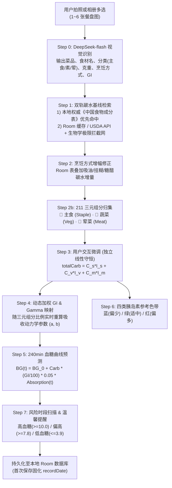

# 糖控助手 (GI-Checker) —— 产品规格书与架构白皮书

> **面向糖尿病患者的 AI 餐盘识别、211 三元组分质量守恒测算与餐后血糖动力学管理客户端**  
> 包名：`com.example.diabetesassistant` · 架构：Kotlin + Jetpack Compose (Clean Architecture + MVVM + Hilt) · 隐私策略：100% 本地私有存储 + 脱敏临床上下文推理

---

## 一、 需求识别与产品定位 (Problem Discovery & Product Positioning)

### 1.1 核心痛点洞察
传统控糖工具及普通热量记录 App 在面对真实的**中国饮食习惯与临床控糖场景**时，存在五大结构性断层：

1. **中餐非标且混炒普遍，估重门槛极高**：一顿正餐往往包含多盘菜肴、汤羹与主食，早期的“硬币参照物”方案拍照摩擦大，且汤品泡发干货（紫菜、木耳）与高水分凝胶甜品（冰粉、凉粉）极易被按膨胀体积高估重量。
2. **海外营养库错配引发“假性爆碳”**：直接以英文词模糊检索 USDA 等海外商业食品库，常将中餐常见食材误匹配为工业深加工制品——例如将 `egg` 匹配为干鸡蛋挂面（57.7g/100g 碳水）、将 `starch jelly`（凉粉/冰粉）匹配为纯玉米干淀粉（98.9g/100g 碳水），导致原本 99% 是水的冰粉与紫菜汤被虚算到近 200g 碳水，严重误导患者心理与胰岛素评估。
3. **进食调节交互违背物理质量守恒**：传统的“荤素比”与“总摄入量”双滑块相互独立，导致当用户选择“吃完 100%”时调节荤素比依然改变结果，或在“50:50 菜肴吃掉 70%”时允许将某一组分拉至 0%，不仅违背质量守恒，更有将蔬菜/勾芡碳水误清零而诱发少打胰岛素、造成餐后高血糖的临床风险。
4. **高 GI 主食与低 GI 蔬菜长期混为一谈**：传统二分法将“米饭、面条”（GI 70~85，碳水密度 25~50g/100g）与“青菜、黄瓜”（GI 15~25，碳水密度 1.5~3.5g/100g）均归为“素”，无法适配糖友“菜肉全吃光、米饭只吃半碗”的日常真实进食模式。
5. **强加单一基线加剧患者焦虑 & 隐私担忧**：一刀切以 `7.8 mmol/L` 划线评判每日趋势容易忽视胰岛素干预人群的差异化目标，增加控糖焦虑；同时病史分型、身高体重、用药及餐食照片属于高度敏感健康隐私，用户不愿将个人身份明细暴露于公网服务器。

### 1.2 目标用户画像
* **核心人群**：1 型 / 2 型糖尿病患者、妊娠期糖尿病患者（需根据每餐吸收碳水估算餐时胰岛素参考区间及关注餐后峰值时段）。
* **扩展人群**：糖前期人群、减脂及血糖平稳管理需求者（关注全天配额、食物 GI 结构与低升糖进餐顺序）。

### 1.3 产品价值主张
* **无摩擦多图快拍**：免除硬币标尺，支持单餐最多 6 张照片（主菜、汤碗、主食分开拍）自动合并测算。
* **中餐权威基线 + 物理守恒算法**：本土《中国食物成分表》权威优先与生物学极限拦截 + **211 控糖三元组分模型（主食 · 蔬菜 · 荤菜）**。
* **去焦虑可视化看板**：围绕患者可掌控的“分时段碳水结构”与“GI 饮食占比”复盘，结合四级医学碳水配额，告别无意义数值焦虑。
* **本地隐私沙盒**：所有用户资料、餐饮照片、健康档案均驻留本地 Room 与 DataStore；AI 问诊前自动执行身份特征脱敏。

---

## 二、 产品功能矩阵与业务闭环 (Functional Definition & Scope)

### 2.1 功能模块全景图

| 一级模块 | 对应实现页面/入口 | 核心功能定义与业务规则 |
| :--- | :--- | :--- |
| **1. 首次建档引导** | [AuthOnboardingScreen.kt](app/src/main/java/com/example/diabetesassistant/ui/screens/AuthOnboardingScreen.kt) | 4 步极简本地初始化流程（欢迎 $\rightarrow$ 亮点认知 $\rightarrow$ 医疗免责声明 $\rightarrow$ 建档录入糖尿病分型、常用胰岛素类型与剂量范围、身高体重）；支持账号登录态与离线单用户无缝初始化。 |
| **2. 首页代谢概览** | [HomeScreen.kt](app/src/main/java/com/example/diabetesassistant/ui/screens/HomeScreen.kt) | 展示“平稳达标 / 偏高警戒 / 高负荷预警”实时状态徽章、今日碳水预算环形进度条（剩余配额计算）、预估热量与膳食纤维、7 日达标平稳度微缩曲线、三大快捷入口（拍餐盘测糖 / 问 GI 助手 / 统计看板）、“今日餐盘便当格子”横向卡片流水与 GI 代谢贴士。 |
| **3. 多图餐盘暂存台** | [CameraCaptureScreen.kt](app/src/main/java/com/example/diabetesassistant/camera/CameraCaptureScreen.kt) | 支持调用系统原生相机（FileProvider）与系统相册多选，单餐最多暂存 **6 张**照片，支持网格缩略图预览、单张移除、一键清空与发起合并 AI 测算。 |
| **4. 识别推理过渡页** | [RecognitionLoadingScreen.kt](app/src/main/java/com/example/diabetesassistant/camera/RecognitionLoadingScreen.kt) | 6 步动态流程播报（图片压缩 $\rightarrow$ 视觉识别 $\rightarrow$ 营养核验 $\rightarrow$ Gamma 模拟 $\rightarrow$ 胰岛素与时段计算 $\rightarrow$ 关怀提醒生成），内置重试机制与防误触返回控制。 |
| **5. 餐盘详情与 211 微调** | [ArchiveDetailScreen.kt](app/src/main/java/com/example/diabetesassistant/camera/ArchiveDetailScreen.kt) | 展示多图画廊、食材明细（区分 `🍚 主食` / `🥦 素` / `🥩 荤` 标签、克重、烹饪方式、GI 及碳水贡献）、餐前血糖基准输入、**211 三元组分独立摄入调节滑块**、胰岛素类型选择器、240 分钟 Vico 预测曲线、三色胰岛素参考区间带、餐后重点关注时段与 AI 提醒卡片；支持首次保存固化原始时间戳 `recordDate` 及历史异常记录自愈。 |
| **6. 多维代谢分析看板** | [ArchiveScreen.kt](app/src/main/java/com/example/diabetesassistant/ui/screens/ArchiveScreen.kt) | 支持 **日 / 周 / 月** 三周期弹性切换：日视图自带水平日历日期滑动条；周期代谢复盘卡（总碳水 / 日均碳水、低 GI 优选率、记录餐次）；分周期交互式碳水堆叠柱状图（点击柱体弹出锚定气泡 Tooltip）；GI 饮食结构分布条；宏量营养素分布卡；历史餐盘记录流水与删除二次确认。 |
| **7. GI 专属健康顾问** | [AiAssistantScreen.kt](app/src/main/java/com/example/diabetesassistant/ui/screens/AiAssistantScreen.kt) | 流式 SSE 问答引擎：本地脱敏注入患者分型、BMI、今日预算及近 5 餐走势；结合本地临床指南库 + 公开医学检索构建循证依据；支持“深度思考 (`deepseek-reasoner`) / 极速回复 (`deepseek-chat`)”切换、可折叠 `<think>` 推理链、快捷症状提问胶囊、Markdown 富文本渲染与引用溯源弹窗。 |
| **8. 个人代谢中心** | [LifeScreen.kt](app/src/main/java/com/example/diabetesassistant/ui/screens/LifeScreen.kt) | 自定义头像与昵称；**四级医学碳水配额弹窗**（`130g 严格 / 160g 稳健 / 210g 适度 / 260g 日常`，默认 180g，支持 50~300g 精细滑动与临床定位实时提示）；深浅外观模式三选一（跟随系统 / 浅色 / 深色）；健康档案参数编辑；本地餐食数据一键重置与医疗声明。 |

### 2.2 端到端核心业务流程



---

## 三、 核心科学算法与质量守恒模型 (Algorithmic & Clinical Engine)

### 3.1 中餐权威库优先与“生物学极限拦截网”
为彻底解决跨语言营养检索失真，[NutritionRepository.kt](app/src/main/java/com/example/diabetesassistant/data/repository/NutritionRepository.kt) 与 [BuiltInCarbFallback.kt](app/src/main/java/com/example/diabetesassistant/data/local/BuiltInCarbFallback.kt) 确立了三层防线：

1. **权威中餐库 100% 优先命中**：内置涵盖熟食主食、高水分凝胶甜品、复水菌藻、汤羹及肉禽蛋类的标准字典（如 `冰粉` `1.5g/100g`、`凉粉` `9.2g/100g`、`鸡蛋` `1.1g/100g`、`熟紫菜` `5.3g/100g`、`熟米饭` `28.6g/100g`、`熟面条` `24.7g/100g`）。命中后零网络延迟直接返回，彻底规避 USDA 将 `egg` 匹配为鸡蛋挂面、将 `starch jelly` 匹配为纯淀粉的错误。
2. **AI Prompt 视觉语义校准**：在 [AnalyzeFoodUseCase.kt](app/src/main/java/com/example/diabetesassistant/domain/usecase/AnalyzeFoodUseCase.kt) 中，明确要求大模型将“透明凝胶+红糖汁+冰块”辨识为**红糖冰粉**并拆分为`冰粉`与`红糖`两项；紫菜/木耳等泡发干货按干重当量（如一碗汤干紫菜 2~5g）估算；主食按熟重估算。
3. **生物学极限校验 (`sanitizeCarbs`)**：针对未命中内置库而回落至缓存或 USDA API 的条目，按品类实施生理学上限拦截（蛋类 $>5\text{g}$ 校准为 $1.1\text{g}$、纯肉鱼虾 $>5\text{g}$ 校准为 $0.2\text{g}$、冰粉凝胶 $>5\text{g}$ 校准为 $1.5\text{g}$、凉粉/魔芋 $>18\text{g}$ 校准为 $9.2\text{g}$、汤品海藻 $>15\text{g}$ 校准为 $5.3\text{g}$）。
4. **历史脏数据自愈 (Auto-Healing)**：在 [CameraRecognitionViewModel.kt](app/src/main/java/com/example/diabetesassistant/camera/CameraRecognitionViewModel.kt) 加载历史档案时，若发现已存食材基准与权威库偏差 $>3.0\text{g}/100\text{g}$，自动触发重算并静默更新数据库记录。

### 3.2 “211 控糖三元组分模型”与严格质量守恒
参考中华医学会糖尿病学分会“211 餐盘法”，系统在 [DishRecognitionResult.kt](app/src/main/java/com/example/diabetesassistant/data/model/DishRecognitionResult.kt) 与 [CarbAndGiCalculator.kt](app/src/main/java/com/example/diabetesassistant/domain/algorithm/CarbAndGiCalculator.kt) 中将所有食材划分至三个正交物理组分，并内建植物含肉字保护列表（`VEGETABLE_EXCLUSIONS`，防止“鸡毛菜、牛蒡、蟹味菇、鱼腥草”被误判为肉类）：

* **物理质量守恒计算**：设主食总碳水 $C_{\text{staple}}$、蔬菜总碳水 $C_{\text{veg}}$、荤菜总碳水 $C_{\text{meat}}$，对应的实际摄入比例滑块独立处于 $[0, 1]$，则：
  $$\text{totalCarbIntake} = C_{\text{staple}} \cdot I_{\text{staple}} + C_{\text{veg}} \cdot I_{\text{veg}} + C_{\text{meat}} \cdot I_{\text{meat}}$$
  * 当全部吃完（均为 $100\%$）时，严格等于盘中原始识别碳水总量，不存在任何人工折算扭曲；
  * 当“菜肉吃完、主食只吃半份”时，仅主食按 $50\%$ 折算，蔬菜纤维保护保留 $100\%$。
* **动态加权 GI 联动**：
  $$\text{GI}_{\text{avg}} = \frac{\sum_{i \in \text{staple}} C_i I_{\text{staple}} \text{GI}_i + \sum_{j \in \text{veg}} C_j I_{\text{veg}} \text{GI}_j + \sum_{k \in \text{meat}} C_k I_{\text{meat}} \text{GI}_k}{\text{totalCarbIntake}}$$

### 3.3 餐后血糖动力学曲线与胰岛素色带参数
* **Gamma 吸收曲线预测**（[BloodSugarPredictor.kt](app/src/main/java/com/example/diabetesassistant/domain/algorithm/BloodSugarPredictor.kt)）：
  $$a = 3.0 - 1.5 \times \frac{\text{GI}_{\text{avg}}}{100}, \quad b = 25 - 5 \times \frac{\text{GI}_{\text{avg}}}{100}$$
  $$\text{Absorption}(t) = \frac{t^a e^{-t/b}}{(ab)^a e^{-a}}, \quad \text{BG}(t) = \text{BG}_{\text{start}} + \text{totalCarbIntake} \times \frac{\text{GI}_{\text{avg}}}{100} \times 0.05 \times \text{Absorption}(t)$$
  输出餐后 `0 ~ 239` 分钟连续波动曲线及预测达峰时间/峰值血糖。
* **四类胰岛素参考区间**（[InsulinBandCalculator.kt](app/src/main/java/com/example/diabetesassistant/domain/algorithm/InsulinBandCalculator.kt) & [InsulinBandParams.kt](app/src/main/java/com/example/diabetesassistant/data/model/InsulinBandParams.kt)）：
  以 `CARB_RATIO = 12g/IU` 计算基准剂量 `baseIU`，在对应胰岛素临床上下限（速效 `1~20 IU`、短效 `2~25 IU`、中效 `4~30 IU`、长效 `6~40 IU`）内划定 **蓝色偏少区**（$\le 0.7 \times \text{baseIU}$）、**绿色适中区**（$0.7 \sim 1.3 \times \text{baseIU}$）与 **红色偏多警戒区**，明确标注起效、峰值与持续时间。
* **重点时段与阈值监测**（[FocusPeriodAnalyzer.kt](app/src/main/java/com/example/diabetesassistant/domain/algorithm/FocusPeriodAnalyzer.kt)）：
  自动扫描预测曲线中 **高血糖**（$\ge 10.0\text{ mmol/L}$）、**偏高预警**（$[7.8, 10.0)\text{ mmol/L}$）与 **低血糖风险**（$\le 3.9\text{ mmol/L}$）连续区间，调用 `DeepSeek-flash` 生成 $\le 30$ 字温和随访提醒。

---

## 四、 视觉传达与设计系统规范 (Visual Communication & Design System)

### 4.1 视觉风格定位：现代 GI 灵动轻愈风格 (Luminous Health Aura)
摒弃传统医疗软件冰冷僵硬的表单表格感，打造**通透、微光、去焦虑、高可读性**的现代健康数字陪伴体验：

* **动态弥散极光背景**（[AmbientGlowBackground.kt](app/src/main/java/com/example/diabetesassistant/ui/components/AmbientGlowBackground.kt)）：底层画布渲染 14 秒与 18 秒异步缓动的薄荷青、薰衣草紫与暖蜜桃杏光球，产生柔和的呼吸生命力。
* **高透光玻璃拟态容器**（[GlassCard.kt](app/src/main/java/com/example/diabetesassistant/ui/components/GlassCard.kt)）：统一采用 `26.dp` 大圆角、线性渐变白/暗黑曜石半透底色与 `1.2.dp` 菲涅尔珠光微反光边框，保证卡片层次分明而前景文字锐利清晰。

### 4.2 双态色彩与语义 Token 体系 ([HealthPalette.kt](app/src/main/java/com/example/diabetesassistant/ui/theme/HealthPalette.kt) & [Theme.kt](app/src/main/java/com/example/diabetesassistant/ui/theme/Theme.kt))

| 语义层级 | 浅色模式 (Light) | 深色模式 (Dark) | 应用场景说明 |
| :--- | :--- | :--- | :--- |
| **品牌主色 Primary** | `#227B4E` (医疗生命绿) | `#4CAF7A` (低眩光森绿) | 主操作按钮、高亮进度、选中态导航胶囊 |
| **画布基底 Background** | `#F6F9F7` / `#F7FAF8` | `#0E1612` (暗墨绿) | 全局页面背景，夜间低眩光护眼 |
| **弥散光晕与粉彩底** | Mint `#E3F5EB` · Lavender `#EBE4F8` · Butter `#FCF4D9` · Peach `#FBE3D8` | 深邃低饱和对应色 (`#183324` / `#2B203C` 等) | 状态标签、热量/纤维/AI 顾问视觉区分 |
| **211 组分专属色** | 主食 `#E67E22` · 蔬菜 `#4B9B6E` · 荤菜 `#E76F51` | 同色系高辨识度保留 | 食材分类徽章、详情三元滑块、日看板堆叠柱状图 |
| **临床预警色** | 偏高 `#F4C84E` · 危险 `#FF5353` · 低糖 `#3E8BFF` | 适度降饱和柔和红 `#E57373` | 曲线阈值提示、胰岛素三色带、异常状态角标 |

### 4.3 排版与防挤压布局守则
* 所有顶部导航栏与状态栏严格绑定 `.statusBarsPadding()` 安全区内边距，彻底消除与系统时间、电量图标重叠问题。
* 核心数字与卡片标题采用 `maxLines = 1` + `softWrap = false` + `TextOverflow.Ellipsis` 防换行策略；配额芯片与 GI 图例均采用均分或弹性间距，杜绝窄屏下百分比文字折行挤压。

---

## 五、 交互设计与体验细节 (Interaction Design & UX Craft)

### 5.1 弹性分体式底部导航栏 ([DiabetesAssistantApp.kt](app/src/main/java/com/example/diabetesassistant/DiabetesAssistantApp.kt))
* **上下文自适应空间管理**：采用中等弹性阻尼弹簧动画（`Spring.DampingRatioMediumBouncy`, `StiffnessMediumLow`）。
  * 在**首页**：`首页 / 档案 / 我的` 三键胶囊占据底部全部宽度，突出当日看板与便当格子，避免冗余按钮干扰。
  * 离开首页进入**档案 / 我的**：右侧平滑弹性收缩主胶囊宽度，同时缩放展开发光圆形**“拍照测糖”浮动主按钮**，实现单手随时快速录入餐食。
  * 进入二级子流程（拍照、loading、详情、AI 顾问）时自动隐藏底栏，最大化沉浸式空间。

### 5.2 去焦虑化、以可行动信息为中心的看板交互
* **替代 `7.8 mmol/L` 焦虑单线**：由于注射胰岛素患者每次餐后波动受药量与基础血糖影响极大，档案看板废弃了单一警戒基线与无意义平均峰值，重构为更具指导意义的**碳水化合物摄入量堆叠柱状图**：
  * **日看板**：严格切分为 **上午 (0~10h)、下午 (11~17h)、晚上 (18~24h)** 3 根柱体，内部按 `主食 / 蔬菜 / 荤菜` 三色堆叠；
  * **周看板 / 月看板**：按 7 天 / 30 天自然日呈现每日总碳水，内部按早、中、晚三时段分色堆叠；
  * **零延迟悬停反馈**：点击任意柱体通过 Window 坐标精准弹出紧贴锚定的悬浮气泡 Tooltip，展示该时段或该日完整拆分数据；点击空白处或切换周期即刻自动销毁。
* **餐后详情三元调节与即时防抖**：拖动 `主食 / 蔬菜 / 荤菜` 任一滑块或点击 `不吃(0%) / 半份(50%) / 全吃(100%)` 快捷芯片后，以 `250ms` 防抖实时联动重算总碳水、动态加权 GI、240 分钟预测曲线及胰岛素色带，顶部展示轻量级加载条，交互丝滑无卡顿。
* **时间戳固化防篡改**：餐食记录在**首次保存**时即锁定 `recordDate`，后续用户回溯档案详情调整食用比例、更新复盘数据时严格沿用原始用餐时间戳，保证每日与分时段历史统计绝对真实不漂移。

### 5.3 本地隐私沙盒与循证流式问诊交互 ([PrivacyDataMasker.kt](app/src/main/java/com/example/diabetesassistant/domain/privacy/PrivacyDataMasker.kt) & [MedicalSearchProvider.kt](app/src/main/java/com/example/diabetesassistant/domain/search/MedicalSearchProvider.kt))
1. **端侧脱敏引擎**：发起 AI 咨询前，`PrivacyDataMasker` 严格剥离用户昵称、账号 ID、头像 URI、真实照片等一切个人身份特征（PII），仅组装匿名化的**分型、胰岛素方案、BMI 体征、今日配额余量及近 5 餐碳水/预测峰值走势**。
2. **双引擎循证检索**：优先零延迟匹配本地内置《中国 2 型糖尿病防治指南 (CDS)》与《ADA 临床诊疗标准》核心条目（覆盖双十五低血糖急救、餐后运动阻断、黎明现象与苏木杰鉴别、科学进餐顺序），弱网下自动优雅降级，有网时补充公开医学检索摘要，并将参考来源以可点击芯片挂载于气泡下方。
3. **思维链可控透明**：用户可在顶栏随时切换 `思考开启 (deepseek-reasoner)` 与快速问答模式，AI 思考过程以折叠卡片实时流式呈现，正式回复采用原生 Compose Markdown 渲染，且强制附带标准化医疗免责提示。

---

## 六、 技术栈、工程架构与本地开发指南 (Tech Stack & Developer Guide)

### 6.1 核心技术栈

| 领域 | 选型与精确版本（源自 [libs.versions.toml](gradle/libs.versions.toml) 与 [app/build.gradle.kts](app/build.gradle.kts)） |
| :--- | :--- |
| **语言与平台** | Kotlin `2.0.21` · Android Gradle Plugin `9.0.1` · `minSdk 34` / `compileSdk 36` / `targetSdk 36` · JVM 17 |
| **UI 与导航** | Jetpack Compose (`Compose BOM 2024.09.00`) · Material 3 · Navigation Compose `2.8.3` |
| **依赖注入与异步** | Hilt `2.57.1` (KSP `2.0.21-1.0.28`) · Kotlin Coroutines & StateFlow |
| **本地持久化** | Room `2.7.2` (Schema `v6`，含 6 张数据表：`users`, `health_profiles`, `food_records`, `cooking_method_table`, `usda_cache`, `ai_chat_messages`) · DataStore Preferences `1.1.1` |
| **网络与多模态 AI** | Retrofit `2.11.0` + OkHttp `4.12.0` + Gson `2.10.1` (对接 DeepSeek-flash / DeepSeek-chat / DeepSeek-reasoner 及 USDA FDC API) |
| **多媒体与图表** | CameraX `1.4.0` + 系统相机/多选相册 · Coil Compose `2.7.0` · Vico `1.15.0` (血糖预测曲线) |

### 6.2 工程包结构说明

```text
app/src/main/java/com/example/diabetesassistant/
├── camera/                   # 拍照暂存台、多图压缩、分析Loading、详情复盘与211三元调整页
├── data/
│   ├── local/                # Room数据库(v6)、6大DAO与Entity、BuiltInCarbFallback中餐权威表、DataStore偏好
│   ├── model/                # DishRecognitionResult(含FoodCategory三元组分分类)、血糖及胰岛素参数模型
│   ├── remote/               # DeepSeekApi、UsdaApi、ApiKeyProvider、OkHttp RetryInterceptor
│   └── repository/           # AiRepository(SSE流式与视觉JSON提取)、NutritionRepository(权威优先+极限拦截)、FoodRecord/UserRepo
├── di/                       # Hilt 全局依赖装配 (AppModule)
├── domain/
│   ├── algorithm/            # CarbAndGiCalculator、BloodSugarPredictor、InsulinBandCalculator、FocusPeriodAnalyzer
│   ├── privacy/              # PrivacyDataMasker (PII 抹除与匿名代谢摘要构建)
│   ├── search/               # MedicalSearchProvider (CDS/ADA 本地临床指南 + 免Key公开医学检索)
│   └── usecase/              # AnalyzeFoodUseCase(Step 0~7 编排)、CalculateBloodSugar/InsulinBand、GenerateAlert
├── navigation/               # AppNavHost、MainDestination、ArchiveSecondaryRoute
└── ui/
    ├── components/           # AmbientGlowBackground、GlassCard、MarkdownText
    ├── screens/              # AuthOnboardingScreen、HomeScreen、ArchiveScreen、AiAssistantScreen、LifeScreen
    └── theme/                # HealthPalette、Theme (三态深浅色切换)、Typography
```

### 6.3 本地配置与构建运行

1. **配置 API Key**：在项目根目录的 `local.properties`（已被 `.gitignore` 忽略，切勿提交到仓库）中添加：
   ```properties
   sdk.dir=YOUR_ANDROID_SDK_PATH
   DEEPSEEK_API_KEY=your_deepseek_api_key
   USDA_API_KEY=your_usda_fdc_api_key
   ```
2. **运行全量单元测试**（覆盖算法守恒、三元组分分类、中餐权威成分表、Prompt 规范、隐私脱敏、时间戳固化、历史数据兼容等 10 个测试套件）：
   ```powershell
   .\gradlew testDebugUnitTest
   ```
3. **编译并安装 Debug APK**：
   ```powershell
   .\gradlew assembleDebug
   adb install -r app\build\outputs\apk\debug\app-debug.apk
   ```

---

## 七、 医疗合规与免责声明 (Clinical Disclaimer)

本应用内置的碳水化合物估算、升糖指数加权、240 分钟血糖动力学模拟曲线、胰岛素剂量参考色带及 AI 健康顾问解答，均基于公开营养学数据库、动力学模型与临床指南文献整理，**仅用于日常饮食健康管理与自我复盘辅助，不构成任何临床诊断或处方建议**。胰岛素实际注射剂量及急症处理（如持续高血糖或低血糖反应）请务必严格遵从执业医师指导。
