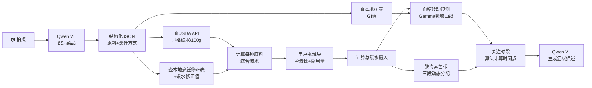
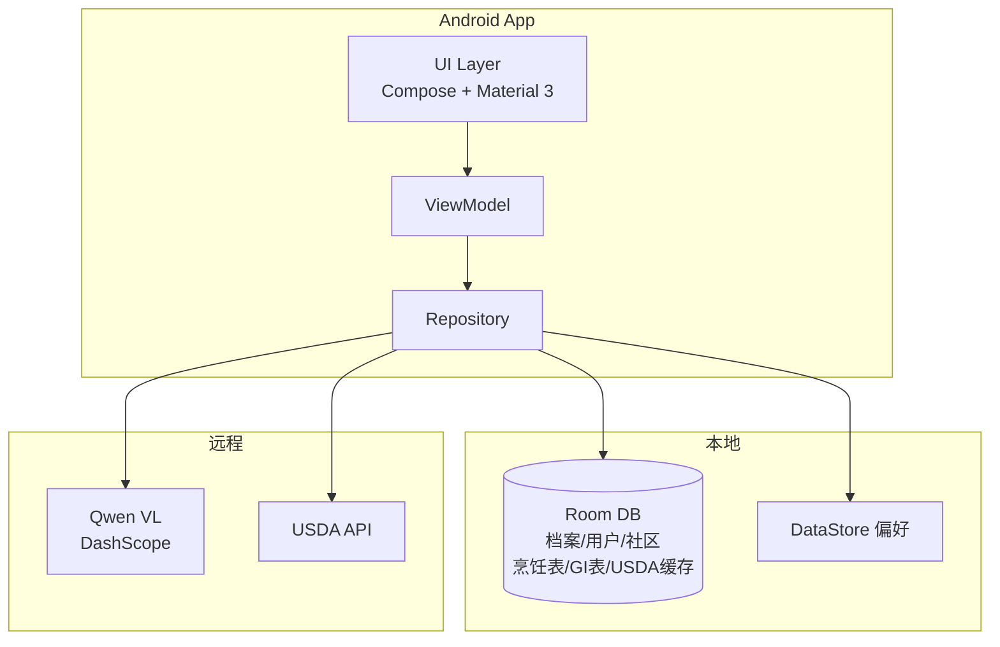

# 糖尿病血糖助手 App — 最终开发文档 (V3 Final)

> **所有需求已确认，本文档为最终开发规范。**

---

## 项目概述

- **目标用户**: 初期糖尿病患者，需控制血糖、注射胰岛素，但不需临床治疗
- **核心定位**: 拍照识别菜品 → 预测血糖波动 → 温馨提醒（非医疗建议）
- **设计风格**: 现代极简 + 玻璃拟态点缀 + 扁平化 icon
- **技术栈**: Android (Kotlin) + Jetpack Compose + Material 3

**主题色板**: `#C2E05E`(强调) / `#A8D4B9`(浅背景) / `#6BBF8B`(主色) / `#4B9B6E`(次主色) / `#2E7E5D`(深色) / `#1A5F3A`(最深)

---

## 已确认决策

| 项目 | 结论 |
|------|------|
| 登录 | 本地模拟（手机号/邮箱+密码，Room DB） |
| AI | Qwen VL — DashScope API |
| 社区 | 本地模拟（Room DB） |
| 血糖单位 | 仅 mmol/L |
| 深色模式 | 三选一：跟随系统/浅色/深色 |
| 糖尿病类型 & 胰岛素类型 | **必填**（Onboarding 引导） |
| 其他健康信息 | 可选填 |
| 离线 | 仅联网 |
| 通知/数据导出/血糖统计 | 不需要 |

---

## 导航架构（分体式设计）

```
╭────────────────────────╮    ╭────────╮
│  🏠    📁    👤        │    │  📷   │
│ 首页  档案夹  我的      │    │ 拍照  │
╰────────────────────────╯    ╰────────╯
 圆角胶囊（玻璃拟态）         独立圆形按钮
```

---

## 四大页面设计

### 一、主页（社区瀑布流）
- 顶部：Logo + 搜索框 + 筛选栏（推荐/最新/关注）
- 双列瀑布流卡片：图片+头像+标题+血糖标签+点赞评论数
- 帖子类型：档案分享 / 自由图文 UGC
- 帖子详情：评论区 + 点赞 + 收藏

### 二、档案夹
- 按日期分组列表，顶部筛选（全部/已完成✅/未确定⚠️）
- 卡片：缩略图+日期+菜品名+状态标识
- 左滑删除（带确认弹窗）

### 三、档案详情页（核心）

从上到下：免责声明小字 → 菜品大图 → 饭前血糖(可选mmol/L) → 荤素比例滑块(音轨丘陵动画) → 总体摄入量滑块(音轨丘陵动画) → 血糖波动预测曲线(不打胰岛素) → 胰岛素用量色带(蓝绿红) → 重点关注时段卡片 → 底部(3个分享icon+确定按钮)

### 四、个人页面
- 玻璃拟态个人卡片（头像+昵称+统计）
- 健康档案（**必填**：糖尿病类型+胰岛素类型；选填：用量范围/体重/身高）
- 功能列表：我的帖子/收藏/外观模式/设置/关于

---

## Onboarding + 登录 + 免责声明

- Onboarding 5页：欢迎→功能亮点→免责声明(强制同意)→必填健康档案→注册登录
- 免责声明常驻：档案详情页顶部浅灰小字 + 个人页"关于"全文 + 分享自动附带

---

## 算法设计（详细版）

### 完整数据流



---

### 1. AI 识别 → 结构化输出

Qwen VL 的 Prompt 要求输出以下 JSON：

```json
{
  "dishes": [
    {
      "dish_name": "番茄炒蛋",
      "ingredients": [
        { "name": "番茄", "category": "素", "weight_g": 150, "cooking_method": "炒" },
        { "name": "鸡蛋", "category": "荤", "weight_g": 100, "cooking_method": "炒" }
      ]
    },
    {
      "dish_name": "红烧肉",
      "ingredients": [
        { "name": "五花肉", "category": "荤", "weight_g": 200, "cooking_method": "红烧" },
        { "name": "冰糖", "category": "素", "weight_g": 15, "cooking_method": "红烧" }
      ]
    }
  ],
  "coin_detected": true,
  "scale_factor": 1.0
}
```

硬币用于估算菜品面积 → 推算各原料重量。

---

### 2. 烹饪方式修正表

> **来源**: 基于食品科学文献（淀粉糊化/油脂吸附/调味料添加）整理的经验值。
> **存储位置**: App 内置 **Room DB 预填充表** `cooking_method_table`，随 App 打包发布。
> **更新方式**: 随 App 版本更新。

| 烹饪方式 | 碳水修正值 (g/100g原料) | 修正原因 |
|----------|------------------------|---------|
| 蒸 | +0 | 无额外碳水添加 |
| 煮/白灼 | +0 | 无额外碳水添加 |
| 炒 | +2 | 少量淀粉勾芡+调味料 |
| 爆炒 | +3 | 较多调味料+酱油中糖分 |
| 红烧 | +5 | 冰糖/白糖+酱油+淀粉勾芡 |
| 糖醋 | +8 | 大量白糖+醋+淀粉勾芡 |
| 油炸 | +6 | 裹粉/面糊（淀粉为主） |
| 干煸 | +3 | 少量淀粉+调味料 |
| 烧烤/烤 | +2 | 烧烤酱/蜂蜜刷料 |
| 凉拌 | +1 | 少量调味料（醋/糖） |
| 煲汤 | +1 | 长时间炖煮，少量调味 |
| 粥/糊 | +0 | 碳水已在原料中（但GI显著升高，由GI表处理） |

**连贯逻辑**:
```
原料综合碳水(g/100g) = USDA基础碳水(g/100g) + 烹饪修正值(g/100g)
原料总碳水(g) = 原料综合碳水(g/100g) × 原料重量(g) / 100
```

---

### 3. GI 升糖指数表

> **来源**: 中国食物成分表 + 国际GI数据库 (University of Sydney) + 医学文献。
> **存储位置**: App 内置 **Room DB 预填充表** `gi_index_table`，随 App 打包发布。
> **更新方式**: 随 App 版本更新。

#### 主食类
| 食物 | GI 值 | 分类 |
|------|-------|------|
| 白米饭 | 83 | 高GI |
| 糙米饭 | 68 | 中GI |
| 白粥/稀饭 | 90 | 高GI |
| 馒头（白面） | 88 | 高GI |
| 全麦面包 | 69 | 中GI |
| 白面条 | 55 | 中GI |
| 米粉 | 60 | 中GI |
| 粉丝（绿豆） | 26 | 低GI |
| 荞麦面 | 45 | 低GI |
| 饺子皮 | 55 | 中GI |

#### 蔬菜类
| 食物 | GI 值 | 分类 |
|------|-------|------|
| 大多数绿叶菜 | ≤15 | 低GI |
| 番茄 | 15 | 低GI |
| 黄瓜 | 15 | 低GI |
| 胡萝卜（生） | 35 | 低GI |
| 土豆（煮） | 78 | 高GI |
| 红薯 | 61 | 中GI |
| 芋头 | 65 | 中GI |
| 南瓜 | 75 | 高GI |
| 玉米 | 55 | 中GI |

#### 荤类/蛋白质
| 食物 | GI 值 | 分类 |
|------|-------|------|
| 猪肉/牛肉/鸡肉/鱼 | ≈0 | — |
| 鸡蛋 | ≈0 | — |
| 豆腐 | 15 | 低GI |
| 牛奶 | 27 | 低GI |

#### 调味/其他
| 食物 | GI 值 | 分类 |
|------|-------|------|
| 白糖 | 65 | 中GI |
| 蜂蜜 | 58 | 中GI |
| 花生 | 14 | 低GI |

**GI分类标准**: 低GI ≤55 / 中GI 56~69 / 高GI ≥70

**连贯逻辑 — GI 如何影响血糖曲线**:

```
1. Qwen VL 识别出原料列表
2. 每种原料在 gi_index_table 中查找 GI 值
   → 找不到时使用默认值（素菜默认20，荤菜默认0，主食默认70）
3. 计算加权平均 GI：
   GI_avg = Σ(原料i碳水占比 × 原料i的GI值)
   其中 碳水占比 = 原料i总碳水 / 全部原料总碳水
4. 将 GI_avg 转化为吸收曲线参数：
   - GI ≥ 70 (高GI): Gamma参数 a=1.5, b=20 → 峰值~30min，血糖升高快
   - GI 56~69 (中GI): Gamma参数 a=2.0, b=22 → 峰值~45min
   - GI ≤ 55 (低GI): Gamma参数 a=3.0, b=25 → 峰值~75min，血糖缓慢上升
5. 代入血糖预测公式：
   BG(t) = BG_start + C_total × (GI_avg/100) × Absorption(t)
```

---

### 4. 血糖波动预测（不打胰岛素）

**目的**: 展示用户不打胰岛素时血糖如何波动

```
BG(t) = BG_start + C_total × (GI_avg / 100) × K × Absorption(t)
```

| 参数 | 含义 | 值 |
|------|------|----|
| `BG_start` | 起始血糖 | 用户输入 或 默认 5.0 mmol/L |
| `C_total` | 总碳水(g) | 碳水算法计算结果 |
| `GI_avg` | 加权平均GI | 上述GI计算 |
| `K` | 碳水→血糖转换系数 | 约 0.05 mmol/L per g（经验值） |
| `Absorption(t)` | 吸收曲线 | Gamma分布，参数由GI决定 |

**曲线时间轴**: 0~4小时，每分钟一个数据点，实时绘制。

---

### 5. 胰岛素用量色带（蓝→绿→红）

> **关键修正**: 色带的首尾数值（总范围）根据用户选择的**胰岛素类型**而变化。

**各类型胰岛素的餐时剂量范围**:

> **来源**: 临床内分泌学指南综合整理。
> **存储位置**: App 内置常量表 `insulin_range_table`。

| 胰岛素类型 | 色带最小值 (IU) | 色带最大值 (IU) | 起效时间 | 峰值时间 | 持续时间 |
|-----------|----------------|----------------|---------|---------|---------|
| 速效（诺和锐等） | 1 | 20 | 10-15min | 1-2h | 3-5h |
| 短效（普通胰岛素） | 2 | 25 | 30-60min | 2-3h | 5-8h |
| 中效（NPH） | 4 | 30 | 1-2h | 4-8h | 12-18h |
| 长效（甘精等） | 6 | 40 | 1-2h | 无明显峰值 | 20-24h |

**三段比率动态分配算法**:

```
输入: 用户碳水摄入量 C_total(g), 用户胰岛素类型 → 对应的 [min_dose, max_dose]

1. 基准剂量 = C_total / 12  (简化的碳水系数，1IU覆盖12g碳水)
2. 将基准剂量映射到 [min_dose, max_dose] 范围内

3. 三段划分:
   蓝色(偏少): [min_dose, 基准剂量 × 0.7]
   绿色(中等): [基准剂量 × 0.7, 基准剂量 × 1.3]
   红色(偏多): [基准剂量 × 1.3, max_dose]

4. 三段在色带上的宽度比例 = 各段数值范围 / 总范围
   → 碳水摄入高时，基准剂量大 → 蓝色段变短，绿色段右移
   → 碳水摄入低时，基准剂量小 → 蓝色段变长，红色段右移
```

**用户不需要理解任何参数**，只需看到色带上三个颜色区间和对应的剂量范围数值。

---

### 6. 重点关注时段

**算法流程**（固定逻辑）:
```
1. 根据血糖曲线 BG(t) 找出所有 BG > 阈值 的时间段
   - 高血糖阈值: 10.0 mmol/L (可能出现口渴/疲倦)
   - 低血糖阈值: 3.9 mmol/L (可能出现头晕/出汗)
   
2. 对每个超阈值时段，取峰值时间点，生成卡片:
   - 时间: "餐后 xx 小时"
   - 预测血糖值
   
3. 将时段列表 + 血糖值发送给 Qwen VL，Prompt:
   "根据以下血糖预测数据，为糖尿病患者生成温馨的关注提醒（非医疗建议），
   语气温和，每条≤30字：[时段数据]"
   
4. AI 返回症状描述，填入卡片
```

时段**不一定递增**——例如某些食物组合可能在1h和3h各出现一个血糖波峰。

---

## 数据表存储总结

| 表名 | 存储位置 | 数据来源 | 更新方式 |
|------|---------|---------|---------|
| `cooking_method_table` | Room DB 预填充 | 食品科学文献整理 | 随App版本更新 |
| `gi_index_table` | Room DB 预填充 | 中国食物成分表+国际GI数据库 | 随App版本更新 |
| `insulin_range_table` | Kotlin 常量对象 | 临床内分泌学指南 | 随App版本更新 |
| 用户档案数据 | Room DB | 用户输入 | 实时 |
| 社区帖子/评论 | Room DB | 用户生成 | 实时 |
| USDA 营养缓存 | Room DB 缓存 | USDA API 在线查询 | 查过的缓存本地 |

---

## 技术架构



**依赖库**: Compose+M3 / Navigation / Room / Retrofit+OkHttp / CameraX / Coil / Vico(图表) / Hilt / DataStore

---

## 模块结构

```
app/src/main/.../diabetesassistant/
├── ui/          (theme/ navigation/ onboarding/ auth/ home/ archive/ camera/ profile/ post/ components/)
├── data/        (local/ remote/ repository/ model/)
├── domain/      (algorithm/ usecase/)
└── di/
```

---

## 验证计划

- **Unit Test**: 碳水计算、GI加权、血糖曲线、胰岛素色带分配
- **UI Test**: 滑块交互、导航、深色模式
- **实机测试**: 拍照、动画流畅度、瀑布流性能

---

**请做最终审阅。确认后即开始执行开发。**
