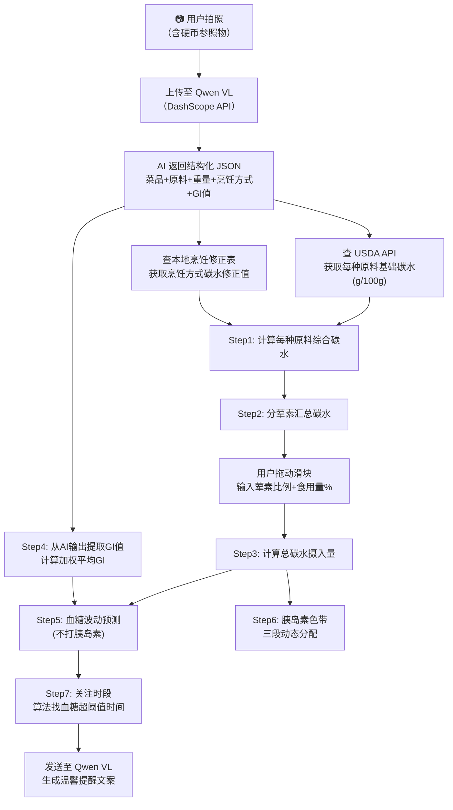
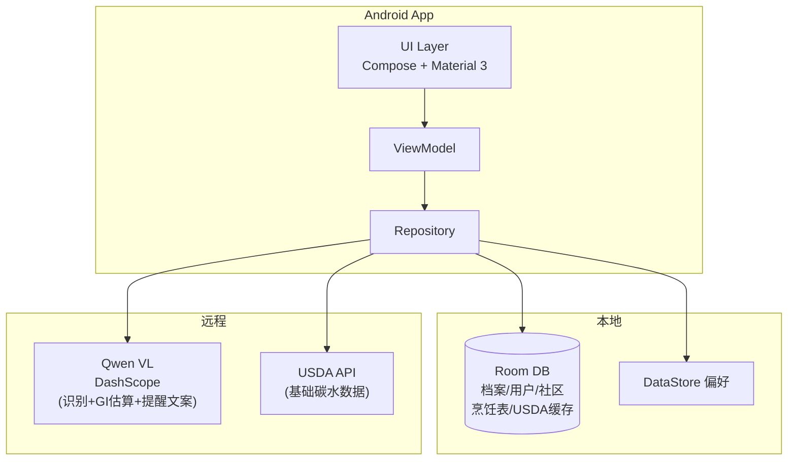

# 糖尿病血糖助手 App — 最终开发文档 (V4)

> **所有需求已确认，本文档为最终开发规范。**

---

## 项目概述

- **目标用户**: 初期糖尿病患者，需控制血糖、注射胰岛素，但不需临床治疗
- **核心定位**: 拍照识别菜品 → 预测血糖波动 → 温馨提醒（非医疗建议）
- **设计风格**: 现代极简 + 玻璃拟态点缀 + 扁平化 icon
- **技术栈**: Android (Kotlin) + Jetpack Compose + Material 3
- **主题色板**: `#C2E05E`(强调) / `#A8D4B9`(浅背景) / `#6BBF8B`(主色) / `#4B9B6E`(次主色) / `#2E7E5D`(深色) / `#1A5F3A`(最深)

---

## 已确认决策

| 项目 | 结论 |
|------|------|
| 登录 | 本地模拟（手机号/邮箱+密码，Room DB） |
| AI | Qwen VL — DashScope API |
| 社区 | 本地模拟（Room DB） |
| 血糖单位 | 仅 mmol/L |
| 深色模式 | 三选一：跟随系统/浅色/深色 |
| 糖尿病类型 & 胰岛素类型 | **必填** |
| GI 值来源 | **AI 估算**（Qwen VL 结构化输出） |
| 离线 / 通知 / 数据导出 | 不需要 |

---

## 导航架构（分体式设计）

```
╭────────────────────────╮    ╭────────╮
│  🏠    📁    👤        │    │  📷   │
│ 首页  档案夹  我的      │    │ 拍照  │
╰────────────────────────╯    ╰────────╯
 圆角胶囊（玻璃拟态）         独立圆形按钮
```

---

## 四大页面设计

### 一、主页

#### 启动欢迎层

App 启动时主页**首先显示全屏欢迎层**：

```
┌─────────────────────────────┐
│                             │
│                             │
│                             │
│   血糖助手已守护您            │  ← 大号字体，主色调
│       XX 天了                │     XX = 注册至今天数
│                             │
│                             │
│         ↓ 下滑探索           │  ← 浅色提示文字+动画箭头
│                             │
└─────────────────────────────┘
```

- 文字居中，字号大（28sp+），使用主色 `#2E7E5D`
- 用户**向下滑动** → 弹簧回弹动效 (spring animation) → 欢迎层向上弹走 → 露出下方社区瀑布流
- 每次进入主页 Tab 都显示欢迎层（非仅首次）

#### 社区瀑布流（欢迎层下方）

**顶部操作栏**:
```
┌─────────────────────────────────────┐
│  ➕         推荐 | 关注 | 商城   🔍 │
│ 发帖icon    ← 筛选标签栏 →    搜索icon│
└─────────────────────────────────────┘
```

- **左侧**: ➕ 发帖 icon（点击跳转发帖页）
- **中间**: 筛选标签栏（推荐 / 关注 / 商城）
- **右侧**: 🔍 搜索 icon → 点击后**横向向左展开搜索输入框**（带动画），输入框内有返回按钮 → 点击返回则**向右收缩回 icon**

**双列瀑布流卡片**: 图片+头像+标题+血糖标签+点赞评论数

**帖子类型**: 档案分享 / 自由图文 UGC

**帖子详情页**: 评论区 + 点赞 + 收藏

---

### 二、档案夹
- 按日期分组列表，顶部筛选（全部/已完成✅/未确定⚠️）
- 卡片：缩略图+日期+菜品名+状态标识
- 左滑删除（带确认弹窗）

---

### 三、档案详情页（核心）

从上到下：免责声明小字 → 菜品大图 → 饭前血糖(可选mmol/L) → 荤素比例滑块(音轨丘陵动画) → 总体摄入量滑块(音轨丘陵动画) → 血糖波动预测曲线(不打胰岛素) → 胰岛素用量色带(蓝绿红) → 重点关注时段卡片 → 底部(3个分享icon+确定按钮)

---

### 四、个人页面
- 玻璃拟态个人卡片（头像+昵称+统计）
- 健康档案（**必填**：糖尿病类型+胰岛素类型；选填：用量范围/体重/身高）
- 功能列表：我的帖子/收藏/外观模式/设置/关于

---

## Onboarding + 登录 + 免责声明

- Onboarding 5页：欢迎→功能亮点→免责声明(强制同意)→必填健康档案→注册登录
- 免责声明常驻：档案详情页顶部浅灰小字 + 个人页"关于"全文 + 分享自动附带

---

## 算法设计（完整版）

### 完整数据流



---

### Step 0: AI 识别 — Qwen VL 结构化输出

**Prompt 设计要点**: 要求 Qwen VL 在识别菜品的同时**估算每种原料的 GI 值**。

```
你是一个食品营养分析专家。请分析图片中的菜品，输出 JSON。
要求：
1. 图片中有一枚硬币作为尺寸参照，据此估算每道菜和每种原料的大致重量
2. 每道菜列出所有主要原料，标注原料名称、荤/素分类、估算重量(g)、烹饪方式
3. 为每种原料估算 GI（升糖指数）值，范围 0~100
4. 最多识别 5 道菜
```

**输出 JSON 格式**:
```json
{
  "dishes": [
    {
      "dish_name": "番茄炒蛋",
      "ingredients": [
        {
          "name": "番茄",
          "category": "素",
          "weight_g": 150,
          "cooking_method": "炒",
          "gi_value": 15
        },
        {
          "name": "鸡蛋",
          "category": "荤",
          "weight_g": 100,
          "cooking_method": "炒",
          "gi_value": 0
        }
      ]
    },
    {
      "dish_name": "红烧肉",
      "ingredients": [
        {
          "name": "五花肉",
          "category": "荤",
          "weight_g": 200,
          "cooking_method": "红烧",
          "gi_value": 0
        },
        {
          "name": "冰糖",
          "category": "素",
          "weight_g": 15,
          "cooking_method": "红烧",
          "gi_value": 65
        }
      ]
    }
  ],
  "coin_detected": true
}
```

---

### Step 1: 计算每种原料的综合碳水

**输入**: AI 输出的原料列表 + USDA 查询结果 + 烹饪修正表

```
原料i综合碳水(g/100g) = USDA基础碳水(g/100g) + 烹饪修正值(g/100g)
原料i总碳水(g) = 原料i综合碳水(g/100g) × 原料i重量(g) / 100
```

**烹饪修正表**（内置 Room DB，随 App 打包）:

| 烹饪方式 | 修正值 (g/100g原料) | 原因 |
|----------|-------------------|------|
| 蒸/煮/白灼 | +0 | 无额外碳水 |
| 凉拌 | +1 | 少量调味料 |
| 煲汤 | +1 | 长时间炖煮 |
| 炒 | +2 | 少量勾芡+调味 |
| 烧烤/烤 | +2 | 烧烤酱/蜂蜜 |
| 爆炒 | +3 | 较多调味+酱油糖分 |
| 干煸 | +3 | 少量淀粉+调味 |
| 红烧 | +5 | 冰糖+酱油+勾芡 |
| 油炸 | +6 | 裹粉/面糊 |
| 糖醋 | +8 | 大量白糖+醋+勾芡 |

**示例**:
```
番茄: USDA碳水=3.9g/100g, 烹饪方式=炒(+2) → 综合碳水=5.9g/100g
番茄总碳水 = 5.9 × 150/100 = 8.85g

鸡蛋: USDA碳水=1.1g/100g, 烹饪方式=炒(+2) → 综合碳水=3.1g/100g
鸡蛋总碳水 = 3.1 × 100/100 = 3.1g
```

---

### Step 2: 分荤素汇总

将所有原料按 `category` 分为荤/素两组：

```
素菜总碳水 = Σ(所有素类原料i的总碳水)
素菜总重量 = Σ(所有素类原料i的重量)
每g素菜碳水 = 素菜总碳水 / 素菜总重量

荤菜总碳水 = Σ(所有荤类原料i的总碳水)
荤菜总重量 = Σ(所有荤类原料i的重量)
每g荤菜碳水 = 荤菜总碳水 / 荤菜总重量

全部菜品总重量 = 素菜总重量 + 荤菜总重量
```

---

### Step 3: 用户输入 → 计算总碳水摄入

用户通过滑块输入两个值：
- **荤素比例** `meat_ratio` (0~1)，其中 0=全素，1=全荤
- **总体食用量** `intake_pct` (0%~100%)

```
总碳水摄入 C_total = 
  [每g素菜碳水 × (1 - meat_ratio) + 每g荤菜碳水 × meat_ratio]
  × intake_pct
  × 全部菜品总重量(g)
```

**每次用户拖动滑块，此公式重新计算 → 触发 Step 5/6/7 更新。**

---

### Step 4: 加权平均 GI 计算

**GI 值来源**: Qwen VL 在 Step 0 的结构化输出中为**每种原料**估算了 `gi_value`。

```
GI_avg = Σ(原料i碳水占比 × 原料i的gi_value) / Σ(原料i碳水占比)

其中: 原料i碳水占比 = 原料i总碳水 / 全部原料总碳水
```

**示例**（番茄炒蛋 + 红烧肉）:
```
全部原料总碳水 = 8.85(番茄) + 3.1(鸡蛋) + 0(五花肉) + 9.75(冰糖) = 21.7g

GI_avg = (8.85/21.7 × 15) + (3.1/21.7 × 0) + (0/21.7 × 0) + (9.75/21.7 × 65)
       = 6.12 + 0 + 0 + 29.22
       = 35.3  →  低GI
```

**GI 影响吸收曲线参数**:

| GI 范围 | 分类 | Gamma 参数 a | Gamma 参数 b | 血糖峰值时间 |
|---------|------|-------------|-------------|-------------|
| ≥70 | 高GI | 1.5 | 20 | ~30 min |
| 56~69 | 中GI | 2.0 | 22 | ~45 min |
| ≤55 | 低GI | 3.0 | 25 | ~75 min |

也可以使用**线性插值**让参数平滑过渡：
```
当 GI_avg 在 0~100 之间:
  a = 3.0 - (GI_avg / 100) × 1.5    // 范围 [1.5, 3.0]
  b = 25 - (GI_avg / 100) × 5       // 范围 [20, 25]
```

---

### Step 5: 血糖波动预测（不打胰岛素）

**公式**:
```
BG(t) = BG_start + C_total × (GI_avg / 100) × K × Absorption(t)
```

| 参数 | 含义 | 取值 |
|------|------|------|
| `BG_start` | 起始血糖 | 用户输入 或 默认 5.0 mmol/L |
| `C_total` | 总碳水(g) | Step 3 计算 |
| `GI_avg` | 加权平均GI | Step 4 计算 |
| `K` | 碳水→血糖转换系数 | 0.05 mmol/L per g |
| `Absorption(t)` | 吸收曲线 | Gamma 分布 |

**Absorption(t) — Gamma 分布归一化**:
```
Absorption(t) = (t^a × e^(-t/b)) / max_value

其中 max_value = (a×b)^a × e^(-a)  // 归一化使峰值=1
t 的单位为分钟，范围 [0, 240]（4小时）
```

**曲线绘制**: 每分钟计算一个 BG(t) 值，共 240 个点，用 Vico 图表库绘制平滑曲线。

**示例**（番茄炒蛋+红烧肉，食用量60%，荤素比0.5）:
```
C_total ≈ 21.7 × 0.6 = 13.02g
GI_avg = 35.3 (低GI) → a=2.47, b=23.24

峰值时间 ≈ a × b = 57 min
峰值血糖 ≈ 5.0 + 13.02 × 0.353 × 0.05 × 1.0 = 5.23 mmol/L
→ 血糖波动不大，属于安全范围
```

---

### Step 6: 胰岛素色带（蓝→绿→红）

色带的**总范围由用户的胰岛素类型决定**：

| 胰岛素类型 | 色带 min (IU) | 色带 max (IU) | 起效 | 峰值 | 持续 |
|-----------|-------------|-------------|------|------|------|
| 速效 | 1 | 20 | 10-15min | 1-2h | 3-5h |
| 短效 | 2 | 25 | 30-60min | 2-3h | 5-8h |
| 中效 | 4 | 30 | 1-2h | 4-8h | 12-18h |
| 长效 | 6 | 40 | 1-2h | 无明显峰 | 20-24h |

**三段动态分配**:
```
1. 基准剂量 = C_total / 12   // 简化碳水系数: 1IU ≈ 12g碳水

2. 将基准剂量限制在 [min, max] 内:
   base = clamp(C_total / 12, min, max)

3. 三段划分:
   蓝色(偏少): [min,          base × 0.7]
   绿色(中等): [base × 0.7,   base × 1.3]
   红色(偏多): [base × 1.3,   max]

4. 色带上的宽度比例 = 各段数值跨度 / 总跨度(max-min)
```

**示例**（速效胰岛素，C_total=50g）:
```
base = 50/12 = 4.17 IU
蓝色: [1, 2.9]     → 宽度占比 10%
绿色: [2.9, 5.4]   → 宽度占比 13%
红色: [5.4, 20]     → 宽度占比 77%
```

**示例**（速效胰岛素，C_total=150g）:
```
base = 150/12 = 12.5 IU
蓝色: [1, 8.75]    → 宽度占比 41%
绿色: [8.75, 16.25] → 宽度占比 39%
红色: [16.25, 20]   → 宽度占比 20%
```

→ 碳水越高，绿色区右移，蓝色区占比变大（因为低剂量相对不足）。

---

### Step 7: 重点关注时段

**算法逻辑**:
```
1. 遍历 BG(t) 曲线 (t = 0~240min)，找出所有超阈值的区间:
   - 高血糖阈值: 10.0 mmol/L
   - 偏高阈值:   7.8 mmol/L (餐后2h标准)
   - 低血糖阈值: 3.9 mmol/L

2. 对每个超阈值区间，取 BG 峰值点的时间 t_peak:
   - 转换为小时: hours = round(t_peak / 60, 1)
   - 记录预测血糖值: bg_value = BG(t_peak)

3. 生成时段卡片列表（不一定递增，按严重程度排序）:
   [
     { "time": "1.5小时后", "bg": 11.2, "level": "high" },
     { "time": "3小时后",   "bg": 3.5,  "level": "low"  }
   ]

4. 将时段列表发送给 Qwen VL 生成温馨提醒:
   Prompt: "根据以下血糖预测，为糖尿病患者生成温馨提醒。
            语气温和，每条≤30字，不是医疗建议:
            - 餐后1.5小时血糖约11.2mmol/L
            - 餐后3小时血糖约3.5mmol/L"
   
   AI返回: 
   - "餐后1.5小时血糖偏高，可适当散步帮助消化哦~"
   - "餐后3小时注意补充少量碳水，避免低血糖头晕~"
```

---

## 数据表存储总结

| 表/数据 | 存储位置 | 来源 | 更新方式 |
|---------|---------|------|---------|
| `cooking_method_table` | Room DB 预填充 | 食品科学文献 | 随App版本更新 |
| `insulin_range_table` | Kotlin 常量对象 | 临床指南 | 随App版本更新 |
| GI 值 | **不内置表** | **Qwen VL 实时估算** | 每次识别时获取 |
| 用户档案/社区帖子 | Room DB | 用户输入/生成 | 实时 |
| USDA 营养缓存 | Room DB 缓存 | USDA API 查询 | 查过的缓存本地 |

---

## 技术架构



**依赖库**: Compose+M3 / Navigation / Room / Retrofit+OkHttp / CameraX / Coil / Vico(图表) / Hilt / DataStore

---

## 模块结构

```
app/src/main/.../diabetesassistant/
├── ui/          (theme/ navigation/ onboarding/ auth/ home/ archive/ camera/ profile/ post/ components/)
├── data/        (local/ remote/ repository/ model/)
├── domain/      (algorithm/ usecase/)
└── di/
```

---

## 验证计划

- **Unit Test**: 碳水计算、GI加权、血糖曲线、胰岛素色带分配
- **UI Test**: 滑块交互、弹簧动效、搜索栏展开收缩、导航、深色模式
- **实机测试**: 拍照、Qwen VL 返回解析、动画流畅度、瀑布流性能

---

**请做最终审阅。确认后即开始执行开发。**
