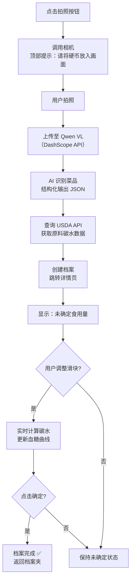
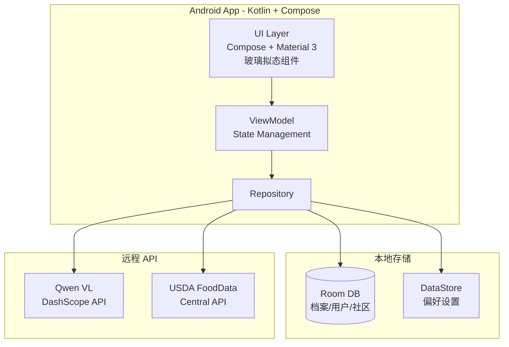

# 糖尿病血糖助手 App — 最终开发文档 (V3 Final)

> **所有需求已确认，本文档为最终开发规范。**

---

## 项目概述

**目标用户**: 初期糖尿病患者，需控制血糖、注射胰岛素，但不需要临床治疗。

**核心定位**: 拍照识别餐桌菜品 → 预测血糖波动 → 给出温馨提醒（非医疗建议）。不做专业血糖监测，只帮助用户留意血糖波动，避免高血糖和低血糖昏厥。

**设计风格**: 现代化极简主义 + 玻璃拟态 (Glassmorphism) 点缀 + 扁平化 (Flat) icon，不使用拟物风格。

**技术栈**: Android (Kotlin) + Jetpack Compose + Material 3

**主题色板**:
| 色号 | 用途 |
|------|------|
| `#C2E05E` | 强调色/亮点（按钮高亮、标签） |
| `#A8D4B9` | 浅背景/卡片底色/玻璃拟态底色 |
| `#6BBF8B` | 主色调（导航栏、关键 UI 元素） |
| `#4B9B6E` | 次主色（图表、进度条） |
| `#2E7E5D` | 深色文字/深色组件 |
| `#1A5F3A` | 最深色（标题、深色模式强调） |

---

## 已确认的决策摘要

| 决策项 | 结论 |
|--------|------|
| 登录方案 | 本地模拟登录（手机号/邮箱 + 密码，本地存储） |
| AI 视觉识别 | Qwen VL — 阿里云 DashScope API |
| 社区数据 | 本地模拟（Room DB，帖子仅本地可见） |
| 血糖单位 | 仅 mmol/L（面向中国用户） |
| 深色模式 | 三种模式供用户选择：跟随系统 / 浅色 / 深色 |
| 糖尿病类型 & 胰岛素类型 | **必填字段**（Onboarding 中引导填写） |
| 其他健康信息 | 可选填（日常胰岛素用量、体重、身高） |
| 离线能力 | 仅联网使用 |
| 通知提醒 | 不需要 |
| 数据导出/血糖统计 | 不需要 |

---

## 导航架构

底部导航采用**分体式设计**（参考导航栏原型图）：

```
┌──────────────────────────────────────────────────┐
│                                                  │
│  ╭────────────────────────────╮    ╭────────╮    │
│  │  🏠    📁    👤           │    │  📷   │    │
│  │ 首页  档案夹  我的         │    │ 拍照  │    │
│  ╰────────────────────────────╯    ╰────────╯    │
│    圆角胶囊导航条（玻璃拟态）      独立圆形按钮     │
└──────────────────────────────────────────────────┘
```

- 左侧胶囊导航条：玻璃拟态（半透明磨砂 + 细微边框），内含 3 个扁平 icon Tab
- 当前选中 Tab 高亮：深色背景圆角矩形 + 图标变色
- 右侧拍照按钮：独立圆形，主色调 `#6BBF8B` 填充
- 所有图标均为扁平化风格

---

## 四大页面详细设计

### 一、主页（首页 + 瀑布流社区）

**布局**: 顶部搜索栏 + 瀑布流卡片（双列）

1. **顶部区域**
   - App Logo + 标题 "糖友圈"
   - 搜索框（搜索菜品/用户/帖子）
   - 筛选标签栏（推荐 / 最新 / 关注）

2. **瀑布流帖子卡片**
   - 内容图片缩略图
   - 用户头像 + 昵称
   - 帖子标题/描述
   - 如果是菜品分享：血糖波动标签（"🟢 低波动"/"🟡 中等"/"🔴 高波动"）
   - 点赞数 + 评论数

3. **帖子类型**
   - **档案分享**: 从档案详情页分享，自带菜品照片 + 血糖预测数据
   - **自由图文 (UGC)**: 用户自行编辑（支持多图 + 文字）

4. **帖子详情页**
   - 完整内容展示 + 评论区 + 点赞 + 收藏

> 社区为本地模拟，所有数据存储在 Room DB 中。

---

### 二、档案夹页面

**布局**: 按日期分组的列表视图

1. **顶部筛选**: 日期范围选择 + 状态筛选（全部 / 已完成 ✅ / 未确定 ⚠️）

2. **档案卡片**
   - 菜品缩略图（左侧）
   - 日期 + 时间（午餐/晚餐标签）
   - 主要菜品名称（最多 3 个）
   - 状态标识：⚠️ 黄色 "未确定食用量" / ✅ 绿色打勾 "已完成"

3. **左滑删除**（带确认弹窗）

---

### 三、档案详情页（核心交互页面）

```
┌─────────────────────────────┐
│ ⚠️ 免责声明（浅灰小字常驻）  │ "以下内容仅供参考，
│                             │  不构成任何医疗建议"
├─────────────────────────────┤
│                             │
│     📷 菜品照片（大图）       │ 可左右滑动多张
│                             │
├─────────────────────────────┤
│ 饭前血糖 (可选)              │
│ ┌─────────────────────┐     │ 输入框 mmol/L
│ │ 请输入 (选填)         │     │ 未填则使用默认值
│ └─────────────────────┘     │ 5.0 mmol/L
├─────────────────────────────┤
│ 素 ●━━━━━━━━━━━━━━━━━ 荤    │ 荤素比例滑块 0~1
│       0    0.5    1         │ 🎵 音轨丘陵动画
├─────────────────────────────┤
│ 总体摄入量 ●━━━━━━━━━━━━━━  │ 食用量 0%~100%
│                             │ 🎵 音轨丘陵动画
├─────────────────────────────┤
│ 血糖波动预测                 │ 不打胰岛素时的
│ ┌───────────────────────┐   │ 血糖变化曲线
│ │  ╱╲    ╱╲             │   │ 起点=饭前血糖
│ │╱  ╲──╱  ╲────────── │   │ 或默认5.0
│ └───────────────────────┘   │ 拖动滑块实时更新
│   0h    1h    2h    3h  4h  │
├─────────────────────────────┤
│ 胰岛素用量参考               │
│ 🔵━━━━━━━🟢━━━━━━━🔴       │ 蓝→绿→红渐变色带
│ 偏少     中等     偏多       │ 三段比率动态调整
│ xx~xx   xx~xx   xx~xx       │
├─────────────────────────────┤
│ 重点关注时段                 │
│ ┌────────┐ ┌────────┐      │ 算法计算时间点
│ │ xx小时后│ │ xx小时后│ ... │ 非固定递增
│ │ 可能出现│ │ 注意…… │      │ 症状描述由AI生成
│ │ xx症状  │ │        │      │
│ └────────┘ └────────┘      │
├─────────────────────────────┤
│ 🔗微信 🔗抖音 🔗社区  [确定] │ 3个分享icon+确定
└─────────────────────────────┘
```

**滑块动画 — "音轨丘陵"效果**:
- 轨道由等距竖条组成（类似音频均衡器）
- 滑块位置附近竖条升高形成丘陵/波浪
- 离滑块越远竖条越低，自然衰减
- 拖动过程平滑过渡动画

**交互逻辑**:
- 拖动滑块 → 血糖曲线实时重绘 + 胰岛素色带区间重新计算
- 血糖预测 = 不打胰岛素的血糖趋势
- 起始血糖 = 用户填写值 || 默认 5.0 mmol/L
- 点击确定 → 档案标记完成 ✅ → 返回档案夹
- 未确定退出 → 显示黄色 ⚠️ 警告

---

### 四、个人页面

1. **个人信息卡片**（玻璃拟态）
   - 头像 + 昵称 + 编辑按钮
   - 统计：记录天数 | 档案数 | 帖子数

2. **健康档案**
   - **必填**: 糖尿病类型（I型/II型/妊娠期/其他）、胰岛素类型（速效/短效/中效/长效）
   - **选填**: 日常胰岛素用量范围、体重、身高

3. **功能列表**
   - 📋 我的帖子
   - ⭐ 我的收藏
   - 🌙 外观模式（跟随系统 / 浅色 / 深色）
   - ⚙️ 系统设置（语言、清除缓存）
   - ℹ️ 关于 / 免责声明全文

---

## 新用户引导 (Onboarding)

| 页面 | 内容 |
|------|------|
| 第 1 页 | 欢迎语 + App 核心价值 |
| 第 2 页 | 功能亮点展示 |
| 第 3 页 | 免责声明（必须阅读并同意） |
| 第 4 页 | **必填**：糖尿病类型 + 胰岛素类型；**选填**：其他健康信息（可跳过选填部分） |
| 第 5 页 | 注册/登录（手机号或邮箱 + 密码） |

---

## 登录方案（本地模拟）

- 注册：用户输入手机号/邮箱 + 设置密码 → 存入 Room DB
- 登录：本地校验手机号/邮箱 + 密码
- 不发送真实验证码，不调用第三方登录 SDK
- 登录状态通过 DataStore 持久化

---

## 免责声明策略

| 场景 | 展示方式 |
|------|---------|
| 首次使用 | Onboarding 第 3 页，强制阅读并同意 |
| 档案详情页 | 顶部常驻浅灰小字（不喧宾夺主） |
| 个人页面 | "关于"中可查看完整全文 |
| 分享内容 | 自动附带小字免责声明 |

---

## 拍照识别流程



---

## 算法设计

### 1. 碳水计算

```
总碳水 = [每g素菜碳水 × 素菜比率 + 每g荤菜碳水 × 荤菜比率] × 食用量% × 菜品总重量(g)
```
- 每种原料碳水 = USDA 基础碳水 + 烹饪方式修正值

### 2. 血糖波动预测（不打胰岛素）

```
BG(t) = BG_start + C_total × GI_factor × Absorption(t)
```
- `BG_start` = 用户输入饭前血糖 或 默认 5.0 mmol/L
- `Absorption(t)` = Gamma 分布近似（高GI峰值~30min，低GI峰值~75min）

### 3. 胰岛素色带（蓝→绿→红）

| 区间 | 颜色 | 含义 |
|------|------|------|
| 左段 | 🔵 蓝 | 剂量偏少 |
| 中段 | 🟢 绿 | 剂量中等 |
| 右段 | 🔴 红 | 剂量偏多 |

- 首尾数值固定，三段比率根据碳水摄入动态调整
- 碳水摄入高 → 绿色区间右移，蓝色区间占比减小

### 4. 重点关注时段

- **算法流程**（固定）：碳水量 + GI 系数 → 计算血糖达到阈值的时间点，非固定递增
- **症状描述**（AI 生成）：将时间 + 预测血糖值发给 Qwen，生成温馨提醒文案

---

## 深色模式

三种模式供用户选择：**跟随系统 / 始终浅色 / 始终深色**

| 元素 | 浅色模式 | 深色模式 |
|------|---------|---------|
| 背景 | `#FAFAFA` | `#121212` |
| 卡片 | `#FFFFFF` | `#1E1E1E` |
| 主色调 | `#6BBF8B` | `#6BBF8B` |
| 文字 | `#1A1A1A` | `#E0E0E0` |
| 玻璃拟态 | 白色半透明 | 深灰半透明 |

---

## 技术架构



**依赖库**:
| 库 | 用途 |
|---|------|
| Jetpack Compose + Material 3 | UI |
| Navigation Compose | 导航 |
| Room | 本地数据库 |
| Retrofit + OkHttp | API 请求 |
| CameraX | 相机 |
| Coil | 图片加载 |
| Vico | 图表（Compose 原生） |
| Hilt | 依赖注入 |
| DataStore | 偏好存储 |

---

## 模块结构

```
app/src/main/java/com/example/diabetesassistant/
├── ui/
│   ├── theme/          # 主题、颜色、深色模式
│   ├── navigation/     # 导航图 + 分体式底部导航栏
│   ├── onboarding/     # 新用户引导
│   ├── auth/           # 本地模拟登录/注册
│   ├── home/           # 社区瀑布流
│   ├── archive/        # 档案夹 + 详情页
│   ├── camera/         # 拍照识别
│   ├── profile/        # 个人页面
│   ├── post/           # 发帖/帖子详情
│   └── components/     # 通用组件（音轨滑块、图表、玻璃卡片）
├── data/
│   ├── local/          # Room DB + DAO
│   ├── remote/         # Qwen VL / USDA Service
│   ├── repository/     # Repository
│   └── model/          # 数据模型
├── domain/
│   ├── algorithm/      # 碳水计算 + 血糖预测 + 胰岛素色带
│   └── usecase/        # 用例
└── di/                 # Hilt 模块
```

---

## 验证计划

- **Unit Test**: 碳水计算、血糖预测模型数学正确性
- **UI Test**: 滑块交互、导航流程、深色模式切换
- **实机测试**: 拍照功能、音轨丘陵动画流畅度、瀑布流性能

---

**请做最终审阅。确认后即开始执行开发。**
